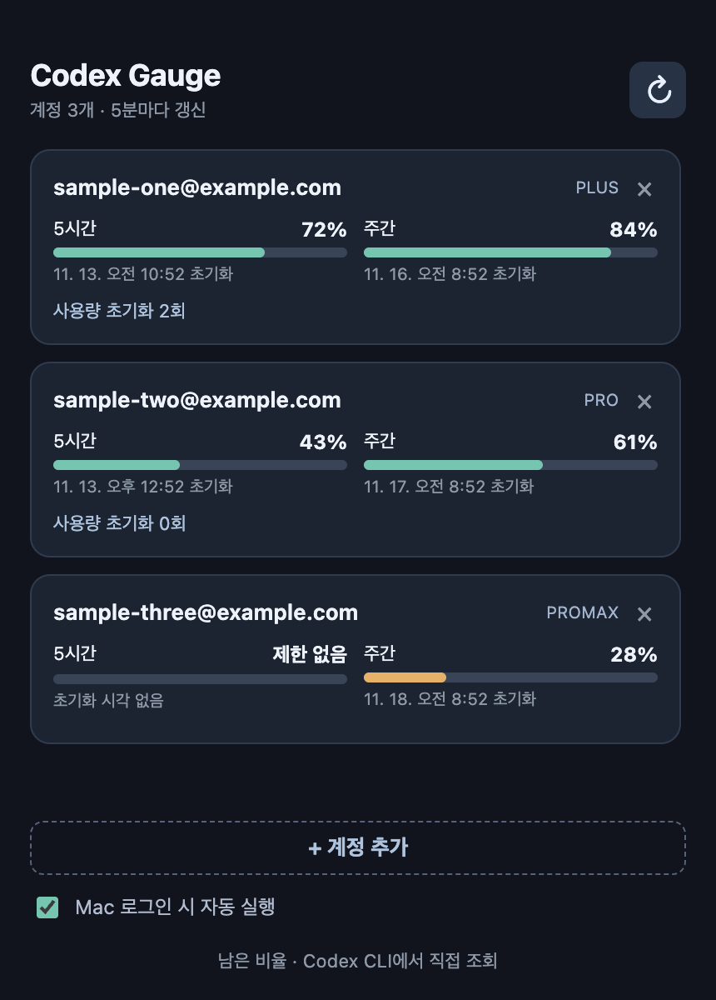
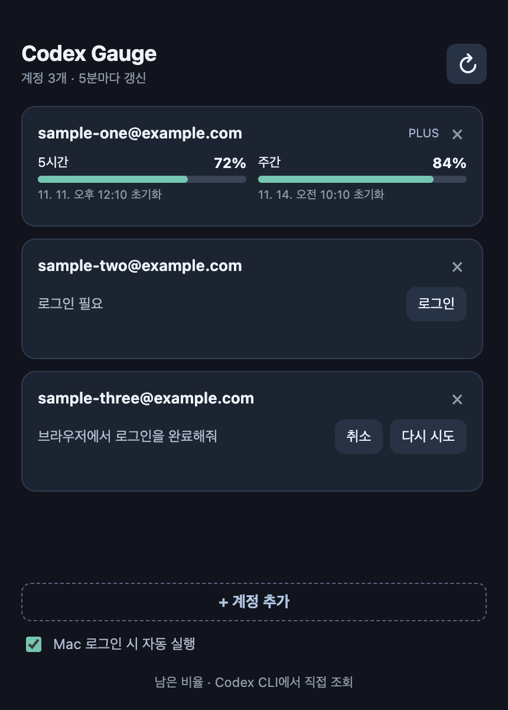

# Codex Gauge

macOS 메뉴 막대에서 여러 Codex 계정의 사용량을 확인하는 비공식 Electron 앱입니다. 각 계정의 남은 5시간·주간 비율과 초기화 시각을 표시합니다. 처음에는 계정 3개가 준비되고 상세 창의 `+ 계정 추가`로 늘릴 수 있습니다.

## 화면 예시

아래 계정 주소와 사용량은 모두 예시 데이터입니다.

| 사용량 확인 | 계정 로그인 |
|:--:|:--:|
|  |  |

## 설치

1. [Releases](https://github.com/heumminJo/codex-gauge/releases/latest)에서 Mac에 맞는 ZIP을 받습니다.
   - Apple Silicon: `Codex.Gauge-*-arm64-mac.zip`
   - Intel: `Codex.Gauge-*-mac.zip`
2. 압축을 풀고 `Codex Gauge.app`을 `응용 프로그램` 폴더로 옮깁니다.
3. [ChatGPT macOS 앱](https://chatgpt.com/features/desktop/) 또는 [Codex CLI](https://learn.chatgpt.com/docs/codex/cli)를 설치합니다. Codex Gauge는 그 안의 공식 Codex CLI로 사용량을 읽습니다.
4. 앱을 실행하고 각 계정의 **로그인**을 눌러 브라우저 인증을 마칩니다. 한 번에 한 계정씩 연결합니다.

현재 배포 파일은 자체 서명되어 있지만 Apple 개발자 서명·공증은 없습니다. macOS가 첫 실행을 막으면 Finder에서 앱을 Control-클릭해 **열기**를 선택하고, 필요하면 **시스템 설정 → 개인정보 보호 및 보안**에서 실행을 허용합니다. 시스템 보안 기능을 끄지 않아도 됩니다.

## 사용

- 메뉴 막대의 게이지 아이콘을 누르면 각 계정 이름과 사용량 비율이 보입니다. 5시간 제한이 없는 계정은 주간 비율만 표시하고, 주간 초기화 시각이 제공되면 다음 줄에 표시합니다. 사용량 초기화 횟수도 값이 있을 때만 추가로 표시합니다.
- 계정 행을 누르면 상세 창이 열립니다. 창의 제목 영역과 상단 빈 공간을 드래그해 이동할 수 있습니다.
- 상세 창의 `+ 계정 추가`를 누르면 새 로그인 섹션이 생깁니다. 추가한 계정은 다음 실행에도 유지됩니다.
- 계정 카드 오른쪽 위 `×`로 계정을 제거할 수 있습니다. 확인하면 이 앱의 해당 계정 로그인 정보도 Mac에서 삭제됩니다. 마지막 계정에는 `×`가 표시되지 않습니다.
- 로그인 페이지에서 취소하거나 실패했다면 앱의 **취소** 또는 **다시 시도**를 누릅니다. 5분 동안 완료되지 않은 로그인은 자동으로 정리됩니다.
- 사용량은 5분마다 갱신됩니다. 메뉴의 **새로고침**이나 창의 `↻` 버튼으로 즉시 확인할 수 있습니다.
- 상세 창 아래의 **Mac 로그인 시 자동 실행**을 켜면 Mac 로그인 후 메뉴 막대에서 시작합니다. 이 설정은 배포용 macOS 앱에서만 사용할 수 있습니다.
- 창을 닫아도 메뉴 막대에서 계속 실행됩니다. 앱 종료는 메뉴의 **종료**를 사용합니다.

`제한 없음`은 해당 요금제에 5시간 제한이 없다는 뜻입니다. `정보 없음`은 Codex CLI가 그 제한 값을 보내지 않았다는 뜻이며, 0%와 다릅니다.

사용량 초기화 횟수는 Codex CLI가 `rateLimitResetCredits.availableCount`를 보낼 때만 표시합니다. 0회도 확인된 값으로 표시하고, 응답에 값이 없으면 숨깁니다.

계정마다 별도의 `CODEX_HOME`을 사용합니다. 인증 정보는 Mac의 Electron 사용자 데이터 폴더 안 `profiles/account-1`, `account-2`처럼 Codex CLI가 저장합니다. Codex Gauge는 비밀번호나 토큰을 화면에 전달하지 않으며 자체 서버로 전송하지 않습니다.

계정 행을 눌러 ChatGPT 데스크톱 앱의 활성 로그인까지 전환하는 기능은 제공하지 않습니다. OpenAI가 공개한 데스크톱 딥링크에는 계정 전환 경로가 없습니다.

## 소스에서 실행

Node.js 22 이상과 npm이 필요합니다.

```sh
git clone https://github.com/heumminJo/codex-gauge.git
cd codex-gauge
npm ci
npm start
```

공식 Codex CLI가 기본 경로에 없으면 `CODEX_CLI_PATH=/absolute/path/to/codex npm start`로 실행합니다. 개발 실행에서는 macOS 앱 메뉴 이름이 `Electron`으로 보일 수 있습니다. 배포용 `Codex Gauge.app`에는 앱 이름이 적용됩니다.

## 개발·빌드

```sh
npm test
npm run dist:mac
```

`dist/`에 Apple Silicon·Intel ZIP이 생성됩니다. macOS에서 빌드해야 합니다. 앱은 Codex CLI의 `account/read`, `account/login/start`, `account/login/cancel`, `account/rateLimits/read`를 사용합니다. 현재 검증한 CLI 버전은 `0.167.0-alpha.3.2`입니다. CLI 계약이 바뀌면 연동을 조정해야 합니다.

Codex Gauge는 OpenAI의 공식 앱이 아니며 OpenAI와 제휴하지 않습니다.
